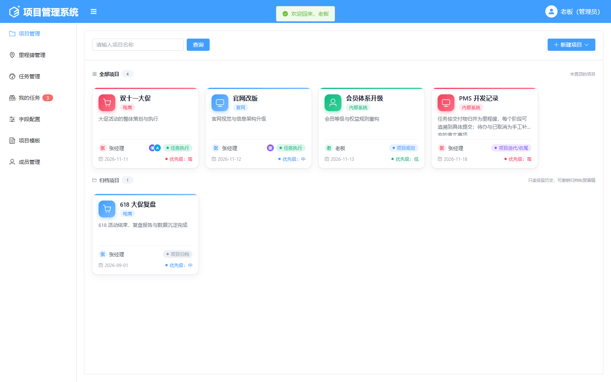
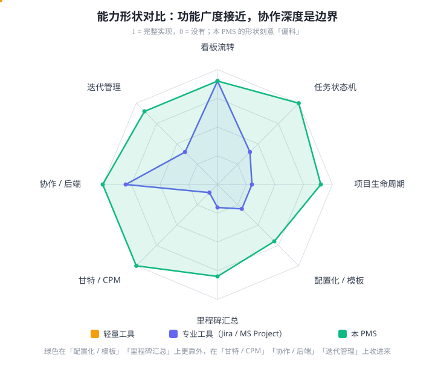

<h1 align="center">PMS 项目管理系统</h1>

<p align="center">
  <a href="https://github.com/MaSaka26/PMS/actions/workflows/ci.yml"></a>
  <a href="https://github.com/MaSaka26/PMS/actions/workflows/deploy-pages.yml"></a>
  <a href="https://nodejs.org/"></a>
</p>

<p align="center">
  
  
  
  
  
  
  
  
</p>

<p align="center">
  一个用 Vue 3 + Mock.js 做的前端项目管理系统：项目 / 任务 / 成员 / 自定义字段 / 模板一条链路闭环，数据存本地浏览器，打开就能演示，不需要后端。
</p>

<p align="center">
  <a href="https://masaka26.github.io/PMS/"><strong>在线演示</strong></a> ·
  <a href="#快速开始">快速开始</a> ·
  <a href="#常见问题faq">常见问题</a>
</p>

<p align="center">
  
</p>

| 适合谁 | 现在就能做什么 | 在线访问 | 边界在哪 |
|---|---|---|---|
| 课程设计 / 演示 / 前端练习 | 登录、建项目、认领任务、验收、看图表、用模板 | [**masaka26.github.io/PMS**](https://masaka26.github.io/PMS/) | 数据只在本机浏览器，不能多人协作 |


## 目录

**先看这些**：[技术栈](#技术栈) · [快速开始](#快速开始) · [测试账号](#测试账号) · [功能模块](#功能模块) · [页面路由](#页面路由) · [常见问题](#常见问题faq)

**深入时再看**：

<details>
<summary>展开完整目录（页面详解 / 权限 / 业务规则 / 数据 / 部署 / 构建 / 决策记录 / 已知限制）</summary>

- [与市面项目管理工具的对比](#与市面项目管理工具的对比)
- [测试与 CI](#测试与-ci)
- [页面详解与代码地图](#页面详解与代码地图)
- [角色与权限](#角色与权限)
- [核心业务规则](#核心业务规则)
- [数据模型（概要）](#数据模型概要)
- [目录结构](#目录结构)
- [数据存储与重置](#数据存储与重置)
- [卡片上的「正在查看」是演示效果](#卡片上的正在查看是演示效果)
- [部署到 GitHub Pages](#部署到-github-pages)
- [构建体积与加载策略](#构建体积与加载策略)
- [决策记录：为什么删掉排期与关键路径](#决策记录为什么删掉排期与关键路径)
- [已知限制](#已知限制)
- [后续规划](#后续规划)

</details>

## 与市面项目管理工具的对比

> 这里的对比是「功能形态」对比，不是产品能力等价。PMS 是前端演示项目，数据只在本机浏览器；表中「有」指页面与交互已实现，不代表多人协作能力。

| 能力 | 轻量工具（Trello / 飞书多维表） | 专业工具（Jira / MS Project） | 本 PMS | 备注 |
|---|---|---|---|---|
| 看板泳道 / 拖拽流转 | 有 | 有 | ✅ 有 | 任务四泳道 + 项目三泳道（含归档） |
| 任务状态机（认领/验收/驳回/重开/取消） | 部分 | 有 | ✅ 有 | 走完整状态机，抽屉时间线留痕 |
| 项目详情 / 生命周期 | 部分 | 有 | ✅ 有 | 阶段自动推导，归档/撤销归档 |
| 成员与角色权限 | 部分 | 有 | ✅ 有 | 4 角色，前端双层校验（演示级） |
| 自定义字段 | 部分 | 有 | ✅ 有 | 任务 + 项目两套命名空间，5 种类型 |
| 项目模板 | 部分 | 有 | ✅ 有 | 字段 + 任务清单 + 相对日期 + 模板内依赖 |
| 里程碑看板 | 部分 | 有 | ✅ 有 | 状态由子任务汇总推导，不允许手改 |
| 我的任务（跨项目聚合） | 部分 | 有 | ✅ 有 | 本人事务五类视图，按截止日期排序 |
| 数据可视化 | 部分 | 有 | ✅ 有 | Highcharts 下钻饼图（任务/负责人分布） |
| 甘特图 / CPM 关键路径 | 无 | 有 | ❌ 有意砍掉 | 见下方「决策记录」；复杂度高、演示频率低 |
| Sprint / 燃尽图 / 迭代 velocity | 部分 | 有 | ❌ 无 | 未做迭代管理 |
| 多人实时协作 / 服务端权限 / 数据库 | 有 | 有 | ❌ 架构边界 | Mock + localStorage，不能多人使用 |
| 附件 / 评论 @ / 通知 | 有 | 有 | ❌ 无 | 演示范围外 |

### 一眼看懂能力形状



绿色是本 PMS：在「配置化 / 模板」「里程碑汇总」上比专业工具更靠外，在「甘特 / CPM」「协作 / 后端」「迭代管理」上刻意收进来。

### 我们有的部分（已实现的功能闭环）

- **任务闭环**：待办 - 认领/指派 - 进行中 - 提交验收 - 验收/驳回 - 已验收；另含阻塞、取消、恢复、重开，抽屉时间线记录全过程。
- **项目闭环**：建项目 - 配成员/字段/模板 - 推进任务 - 阶段自动推导 - 归档/撤销归档。
- **跨项目视图**：我的任务把「我负责 / 待我验收 / 我建的待认领 / 逾期」聚合成五类视图，按截止日期升序，打开就能看到今天该干什么。
- **配置化能力**：任务与项目各有独立字段配置；项目模板可沉淀字段 + 任务清单 + 相对日期 + 依赖，新建项目时一键套用。

### 差异化部分（和主流工具不一样的做法）

| 差异化点 | 市面常见做法 | 本 PMS 做法 | 为什么有意思 |
|---|---|---|---|
| **字段配置 + 项目模板** | 字段写死在代码里，或模板只带任务标题 | 把变化推到配置层：任务/项目两套字段可增删改，模板连字段和相对日期一起沉淀 | 需求变动不改代码，改配置即可，这是轻量产品少有的 |
| **里程碑状态自动推导** | 手填里程碑状态，或把里程碑当普通任务 | 完全由子任务汇总：全 accepted 得 accepted；有 done 得 done；有 doing 得 doing；全 todo 得 todo；接口不允许手改 status | Jira Epic / Azure DevOps 阶段的思路，避免「里程碑绿了但任务没做完」 |
| **项目阶段自动推导** | 手填项目状态 | draft - planning - active - accepting - iterating，由里程碑/任务进度算出来 | 少维护一个状态，且阶段与真实进度不会脱节 |
| **排期能力有意砍掉** | 堆甘特图 + 关键路径，越做越复杂 | 记录决策：演示频率低、维护成本高，砍掉；保留字段不删 | 知道「不做什么」比堆功能更成熟，见决策记录章节 |
| **零后端可演示** | 需要部署服务端才有数据 | 打开 GitHub Pages 即用，mock 数据 + localStorage | 作品展示、课程设计场景友好，不需要数据库 |

## 技术栈

| 类别 | 技术 |
|---|---|
| 框架 | Vue 3（`<script setup>`） |
| 路由 | Vue Router 5（Hash 模式，兼容 GitHub Pages） |
| 状态管理 | Pinia 4（setup stores） |
| UI 组件 | Element Plus 2 |
| 图表 | Highcharts 13（向下钻取饼图） |
| 数据模拟 | Mock.js |
| 构建工具 | Vite 8 |
| 样式 | SCSS |

Node 版本要求：`^22.18.0 || >=24.12.0`。

## 快速开始

> [!NOTE]
> 前置条件：Node `^22.18.0 || >=24.12.0`，npm。仓库根目录是 `PMS/`，以下命令都在该目录执行。

**1 · 安装依赖**

```bash
cd PMS
npm install
```

**2 · 启动开发服务器**

```bash
npm run dev
```

启动后访问终端提示的地址（默认 `http://localhost:5173`），在登录页用 `admin/admin` 或 `pm/pm` 登录。

**3 · 验证没有改坏**

```bash
npm run test
npm run build
npm run preview
```

## 测试与 CI

- `tests/*.test.js` 覆盖权限判断、截止日期分级、登录与停用校验、种子数据日期合法性、种子指纹重置策略、domain 纯函数（不加载 mock）、接口级 403 兜底，使用 Node 内置 `node:test`，无需额外测试依赖。其中权限测试同时锁住「验收权限只认管理员和项目负责人」与「自己验收自己只标记不拦截」两条约定，避免以后有人把职责分离写成硬拦截，把项目阶段卡死在「任务验收」。
- `tests/on-demand.test.js` 守 Element Plus 按需引入的四个静默失效点：扫 `src/` 下所有 `<el-xxx>` 标签与 `from 'element-plus'` 的具名导入，逐个核对（1）样式目录存在（2）`main.js` 里 import 了样式（3）标签注册成了全局组件；另外单独检查 `ElMessage` / `ElMessageBox` / `v-loading` 这三个不在模板里的样式。解析 `main.js` 前会先剥注释，注释掉的 import 不会被当成还在。
- `tests/seed-signature.test.js` 锁住重置策略的四种情况：从没存过 → 重置；本地版本更旧 → 重置；**本地版本更新 → 不重置**（防止浏览器缓存到旧 bundle 时把新数据刷掉）；版本相同但指纹不同 → 重置。重置判定抽成 `shouldResetSeed()` 纯函数就是为了能在没有 localStorage 的 node 环境里测。
- `.github/workflows/ci.yml` 在 pull request 与非 `master` 分支的 push 时执行：安装依赖 → 单元测试 → 生产构建；`master` 的推送由部署工作流负责。
- 页面与 Mock 流程仍以手工冒烟验证为主。

## 测试账号

| 用户名 | 密码 | 角色 | 姓名 |
|---|---|---|---|
| admin | admin | 管理员 | 老板 |
| pm | pm | 项目经理 | 张经理 |
| member | member | 成员 | 李员工 |
| agent | agent | 成员 | Agent |

用 `pm/pm` 登录可以直接看到「我的任务」的分类效果：他是「双十一大促」「官网改版」的负责人，名下有 2 条自己负责的进行中任务（其中 1 条已逾期）、3 条待他验收的提交、4 条他创建但还没人认领的待办。

项目看板里的「PMS 开发记录」是一份写死的演示种子：`src/mock/db/seed/tasks.js` 里的 `seedMilestones` 目前共 13 条独立里程碑实体，其中这个项目有 6 条（M0 项目骨架 → M1 MVP 可运行 → M2 Pages 上线 / M3 自举数据 / M4 组件化重构 → M5 交互打磨），每条保留交付说明、判据与 commitHashes，可追溯到具体 hash；`src/mock/db/seed/projects.js` 里写死项目起止日期与成员（u5 开发者 + u2 项目经理）。里程碑放在「里程碑管理 → 里程碑看板」展示，项目详情的「里程碑」tab 也能按项目查看；任务通过 `milestoneId` 挂到里程碑下，状态由子任务汇总。其余四个种子项目（双十一大促 / 官网改版 / 会员体系升级 / 618 复盘）也补齐了各自的里程碑，所有项目任务都挂到同项目的里程碑下，项目详情页右上角「打开里程碑看板」带 `projectId` 跳过去只看当前项目。原来的 `npm run seed:git` 生成器与 `gitSeed.js` 已移除，种子不再随仓库 commit 变动。

里程碑额外记录独立的「计划工期 duration（天）」和「承诺截止 commitment.dueDate」：工期决定时间线上横条的长度，承诺截止用竖线标出，实际提交日只作为对照——「计划给几天」和「git 实际在哪天提交」是两个字段，不再混为一谈。已验收里程碑只有在「实际结束晚于承诺截止」时才算逾期，不会因为今天更晚就一律标红。
里程碑状态（todo/doing/done/accepted/canceled）不设「验收里程碑」按钮，而是由它下面的子任务（`task.milestoneId` 指向它）汇总推导：全部子任务 accepted 才算 accepted，有 done 算待验收，有 doing 算进行中，全 todo 算待办，全取消算 canceled；日期与状态分离，逾期完成仍是 accepted，逾期只单独标记并下钻到拖慢的子任务。这是敏捷里常见的做法——人只管做任务，阶段到没到由系统汇总；`src/mock/api/milestone.js` 的编辑接口已屏蔽 `body.status`，不允许手改绕过推导。

归并的判据是「去掉这一步，后面哪一步会做不了」：有答案的留下，没有答案的并入相邻里程碑。24 条提交里只有 6 条符合这个标准，其余 18 条是同一批交付的补丁（例如 `73ba9ba` 是 `7e8adf0` 置顶泳道的补丁，间隔 12 分钟）。直接一条提交一个任务会让看板失去阶段感，也无法表达任务间的先后约束。

里程碑之间没有假的关键路径：M2、M3、M4 都是 M1 之后并行的交付面，串成 `M0→M1→M2→M3→M4→M5` 会凭空造出一条并不存在的依赖链。另外手工补充了 2 条真实待办（拆分主包挂在 M4 下、升级 Actions 挂在 M2 下）和 2 条已取消任务（排期视图、CPM 关键路径），因为这些工作没有落地，不会出现在提交历史里。

登录后会写入 `pm_token`，未登录访问业务页面会被路由守卫重定向到登录页。

## 功能模块

- **项目管理**：项目增删改查、优先级、负责人、成员、计划周期、关闭并归档、撤销归档、项目详情、动态时间线。
- **任务看板**：四泳道（待办 / 进行中 / 待验收 / 已验收）、认领、显式指派、提交验收、验收、驳回、重开、阻塞、取消、恢复、任务详情抽屉与事件时间线；支持按标题关键字、负责人、阻塞状态筛选。
- **我的任务**：按登录人聚合「全部 / 我负责的 / 待我验收 / 我建的待认领 / 逾期」五类视图，跨项目视图，默认按截止日期升序，逾期行标红，支持优先级、状态、关键字筛选。
- **成员管理**：按角色分为管理员 / 项目经理 / 成员三条泳道，支持岗位、搜索、详情预览、分级权限、停用/启用和登录账号开通。
- **字段配置**：任务字段与项目字段两套命名空间，支持单行文本、多行文本、数字、日期、单选；支持必填、说明、选项、启停、排序、删除。
- **项目模板**：模板配置（字段 + 任务清单 + 相对日期 + 模板内依赖）、套用模板创建项目、从已有项目另存为模板、看板内模板选择入口。
- **数据概览**：项目详情中的任务分布与负责人分布下钻饼图、最近动态。
- **布局**：固定头部、侧边栏，内容区使用 `el-scrollbar` 独立滚动。

## 页面路由

| 路径 | 说明 |
|---|---|
| `/login` | 登录页 |
| `/mine` | 我的任务（按登录人聚合的本人事务） |
| `/project/board` | 项目看板（置顶 / 全部 / 归档三条泳道） |
| `/project/:id` | 项目详情（归档项目复用同一路由，只读） |
| `/task/board` | 任务看板 |
| `/milestone/board` | 里程碑看板（可切换横轴时间 / 横轴里程碑；筛选只隐藏内容不改坐标轴，逾期下钻到子任务） |
| `/field` | 字段配置 |
| `/template` | 项目模板 |
| `/member` | 成员管理 |

项目管理、任务管理、里程碑管理都只保留一级菜单，点进去直接是看板；「我的任务」也独立成一级。**路由层面所有看板都是一级路由**，没有父级的模块壳路由，页面不再渲染面包屑。项目归档不再是独立页面，而是项目看板的第三条泳道；归档项目详情与普通项目详情统一走 `/project/:id`，由项目状态决定只读模式与返回路径。流程说明页（项目流程 / 任务流程）已删除，规则备份在「核心业务规则」一节。

项目使用 Hash 路由，部署到 GitHub Pages 后地址形如 `https://用户名.github.io/PMS/#/login`。

<details>
<summary>页面详解与代码地图（9 个页面逐页说明 + 依赖速查）</summary>

## 页面详解与代码地图

#### 页面关联总览

```
字段配置 ──→ 任务表单 / 项目表单
成员管理 ──→ 角色权限、项目负责人、任务负责人、登录账号
项目模板 ──→ 套用模板 ──→ 项目看板 ──→ 项目详情
                                      │
                                      └─→ 任务看板 ──→ 项目阶段自动推进
任务操作 ──→ 任务事件 / 项目动态 / 详情图表
任务 ──→ 我的任务（按登录人聚合的本人事务，跨项目）
项目关闭 ──→ 项目看板「归档」泳道 ──→ 撤销归档
项目阶段 / 任务流转规则 ──→ 核心业务规则（原流程页内容已并入）
```

#### 代码分层约定

| 层 | 位置 | 职责 |
|---|---|---|
| 页面 | `src/views/**` | 编排数据加载、权限判断、弹窗开关和页面交互 |
| 组件 | `src/views/**/components`、`src/components` | 可复用的展示与交互单元，不直接写业务接口 |
| 状态 | `src/stores/**` | 跨页面共享的数据，如成员列表、任务缓存、字段配置 |
| 请求 | `src/api/**` | axios 封装，页面只关心调用和结果 |
| 模拟后端 | `src/mock/**` | 接口注册、事件日志、localStorage 持久化；权限判定统一调 `utils/permissions.js` |
| 业务规则 | `src/domain/**` | 项目阶段推导、任务状态机与日期依赖校验（与存储层解耦的纯逻辑） |
| 公共能力 | `src/utils/**`、`src/constants/**` | 权限、日期（`todayLocal` 一律走本地时区）、幂等加载、状态常量等纯逻辑 |
| 服务注入 | `src/domain/services.js` | domain 纯规则通过注入获取 db/身份/保存，不 import mock；测试可在无 mock 环境下跑纯函数 |

理解这个项目时，可以按「页面 → 组件 → store → api → mock」的顺序追一条业务链路。

一条典型业务链路：

1. 管理员在「字段配置」定义任务字段和项目字段。
2. 在「项目模板」配置默认字段和任务清单。
3. 在「项目看板」从模板创建项目，生成项目和待办任务。
4. 成员在「任务看板」认领任务，项目自动进入「任务执行」。
5. 任务提交验收、验收通过，项目阶段自动推进到「任务验收」「项目收尾」。
6. 成员在「我的任务」看自己当前该做什么，项目负责人在同一页看到「待我验收」的提交。
7. 项目详情实时展示任务分布、负责人分布和最近动态。
8. 项目结束可在看板关闭并归档，或从详情另存为新的模板。

---

#### 1. 登录页 `/login`

**页面职责**：账号密码登录、三个种子账号快捷填充、错误提示、登录后跳回原目标页。

**主要功能**

- 表单校验用户名和密码
- 点击快捷账号自动填入 admin / pm / member
- 登录成功后写入 token，拉取用户信息
- 停用账号登录时提示「账号已停用，请联系管理员」

**核心代码**

| 文件 | 作用 |
|---|---|
| [Login/index.vue](src/views/Login/index.vue) | 登录表单、快捷填充、调用 `userStore.login` |
| [stores/userStore.js](src/stores/userStore.js) | 保存 token、用户信息、恢复登录态、退出登录 |
| [mock/api/user.js](src/mock/api/user.js) | `/api/login`、`/api/info` 接口 |
| [mock/services/auth.js](src/mock/services/auth.js) | 账号密码校验、停用检查、当前用户解析 |
| [router/index.js](src/router/index.js) | 路由守卫：未登录跳登录页，token 变化时校验 `/info` |

**与其他页面的关系**：登录身份决定所有页面的角色和权限；成员页修改角色或停用后，登录和接口权限同步变化。

---

#### 2. 项目看板 `/project/board`

**页面职责**：项目列表、搜索、分页、新建（空白 / 从模板）、编辑、关闭归档、撤销归档、删除、进入详情。

**主要功能**

- 三条泳道：置顶项目、全部项目（未置顶）、已归档项目（只读，可撤销归档）
- 卡片展示图标、名称、类型、负责人、优先级、项目阶段
- 卡片右下角偶尔出现同事头像，是本地模拟的「正在查看」演示效果（见 [卡片上的「正在查看」是演示效果](#卡片上的正在查看是演示效果)）
- 按名称搜索，分页展示
- 「新建项目」下拉：新建空白项目 / 从模板创建
- 只有项目负责人或管理员能看到编辑、关闭、删除操作
- 项目经理创建项目时负责人固定为自己
- 归档卡片提供「撤销归档」操作（项目负责人 / 管理员），关闭后项目从「全部」泳道移入「归档」泳道
- 卡片点击进入项目详情（统一 `/project/:id`）

**核心代码**

| 文件 | 作用 |
|---|---|
| [project/index.vue](src/views/project/index.vue) | 三条泳道加载、搜索分页、权限判断、新建/编辑/关闭/撤销归档/删除 |
| [project/components/card.vue](src/views/project/components/card.vue) | 项目卡片与状态、优先级、操作按钮（含归档卡的撤销归档） |
| [components/DemoViewers.vue](src/components/DemoViewers.vue) | 卡片右下角的「正在查看」头像堆叠（演示）；任务卡传 `task-id`，项目卡传 `project-id` + `task-ids` 由它汇总 |
| [project/components/ProjectFormDialog.vue](src/views/project/components/ProjectFormDialog.vue) | 项目表单、图标选择、计划周期、项目自定义字段 |
| [template/components/TemplatePickerDialog.vue](src/views/template/components/TemplatePickerDialog.vue) | 从模板创建项目的选择弹窗 |
| [mock/api/project.js](src/mock/api/project.js) | 项目增删改查、归档过滤、权限与日期校验 |
| [domain/project-status.js](src/domain/project-status.js) | 读取项目时按任务规范化项目阶段 |

**与其他页面的关系**：项目来源于空白创建或模板套用；项目负责人和成员来自成员管理；任务状态会反向推动项目阶段；项目关闭后进入本页的归档泳道。

---

#### 3. 项目详情 `/project/:id`

**页面职责**：单个项目的完整视图，包括指标、图表、任务、里程碑、成员、动态和项目操作。

**主要功能**

- 八个指标卡：任务总数、进行中、待验收、已验收、阻塞、逾期、成员数、完成率；右上角按钮在「一行八列 / 两行四列」之间切换，偏好记在 `localStorage.pm_stat_layout`
- 卡片可点：状态类卡片跳到「任务」tab 并带上对应筛选；阻塞/逾期卡片勾上「仅看阻塞 / 仅看逾期」；成员数卡片跳到「成员」tab；完成率是纯展示，不响应点击
- 任务分布下钻饼图：状态 → 负责人
- 负责人分布下钻饼图：负责人 → 状态
- 最近动态、任务列表、里程碑列表、成员列表；动态里包含 `pm_changed`（负责人交接，带原负责人 → 新负责人与原因）
- 里程碑列表按交付阶段展示每个里程碑的状态、承诺截止与子任务验收进度；右上角「打开里程碑看板」跳到 `/milestone/board?projectId=...`，只看当前项目。里程碑看板默认不显示归档项目；工具栏「不含归档 / 含归档」开关可切换，从归档项目详情跳进去时会自动打开开关并显示该项目的里程碑
- 逾期任务在列表里整行标红，与指标卡「逾期」口径一致（无截止日期或已验收/已取消不计）
- 点击任务打开任务详情抽屉
- 关闭并归档、撤销归档、另存为模板（归档项目与普通项目共用本页，按项目状态切换只读模式）
- 归档项目只读，非项目成员显示 403

**核心代码**

| 文件 | 作用 |
|---|---|
| [project/detail.vue](src/views/project/detail.vue) | 详情数据、指标计算、动态、任务表格、权限和项目操作；`/project/:id` 单路由，按 `project.status === 'archived'` 判断只读与返回 |
| [project/components/DrilldownPieChart.vue](src/views/project/components/DrilldownPieChart.vue) | Highcharts 下钻饼图，支持状态与负责人两个维度 |
| [task/components/TaskDrawer.vue](src/views/task/components/TaskDrawer.vue) | 任务详情与事件时间线 |
| [components/DueBadge.vue](src/components/DueBadge.vue) | 截止日期倒计时徽标 |
| [stores/taskStore.js](src/stores/taskStore.js) | 项目任务列表与任务详情缓存 |
| [stores/fieldStore.js](src/stores/fieldStore.js) | 项目字段定义与展示 |
| [project/components/DetailActivity.vue](src/views/project/components/DetailActivity.vue) | 动态时间线，含负责人交接记录的文案拼装 |
| [project/components/DetailMilestoneList.vue](src/views/project/components/DetailMilestoneList.vue) | 项目里程碑列表，状态由子任务汇总、逾期单独标记 |
| [stores/milestoneStore.js](src/stores/milestoneStore.js) | 里程碑列表与详情缓存，按项目筛选 |
| [mock/api/project.js](src/mock/api/project.js) | 详情、动态、归档与撤销归档接口；改负责人时写 `pm_changed` 事件 |

**与其他页面的关系**：数据来自任务看板的任务、成员管理的成员、字段配置的项目字段；任务状态变化会反映在图表和动态中；关闭后项目进入看板归档泳道；另存为模板会跳到项目模板体系。

---

#### 4. 任务看板 `/task/board`

**页面职责**：按项目查看任务泳道，执行认领、指派、验收、阻塞、取消等全部任务操作。

**主要功能**

- 四泳道：待办、进行中、待验收、已验收
- 按标题关键字、负责人、仅看阻塞筛选
- 新建 / 编辑任务，支持计划开始、截止日期、前置任务和自定义字段
- 待办卡片支持「认领」和「指派」：认领只能给自己，指派由项目负责人/管理员操作
- 提交验收、验收、驳回、重开、阻塞、取消、恢复、删除
- 已取消任务折叠区
- 任务详情抽屉展示扩展信息和事件时间线

**核心代码**

| 文件 | 作用 |
|---|---|
| [task/index.vue](src/views/task/index.vue) | 项目切换、筛选、泳道分组、权限、任务表单和操作 |
| [task/components/TaskCard.vue](src/views/task/components/TaskCard.vue) | 任务卡片、优先级、截止徽标、依赖提示、认领/指派等操作按钮 |
| [components/DemoViewers.vue](src/components/DemoViewers.vue) | 卡片右下角的「正在查看」头像堆叠（演示）；任务卡传 `task-id`，项目卡传 `project-id` + `task-ids` 由它汇总 |
| [task/components/AssignTaskDialog.vue](src/views/task/components/AssignTaskDialog.vue) | 显式指派弹窗：选择项目成员并确认 |
| [task/components/TaskDrawer.vue](src/views/task/components/TaskDrawer.vue) | 任务详情、扩展字段、事件时间线 |
| [stores/taskStore.js](src/stores/taskStore.js) | `taskMap`、任务详情、认领/阻塞/取消/恢复 |
| [mock/api/task.js](src/mock/api/task.js)、[domain/task-rules.js](src/domain/task-rules.js) | 任务接口；状态机、权限校验、日期与依赖校验、事件日志、项目阶段同步 |
| [constants/status.js](src/constants/status.js) | 任务状态、项目状态、优先级常量 |
| [utils/due.js](src/utils/due.js) | 截止日期分级计算 |

**与其他页面的关系**：任务属于某个项目；负责人来自成员管理；任务字段来自字段配置；任务状态变化会推动项目阶段，并影响项目详情的指标、图表和动态；模板生成的任务直接出现在这里。

---

#### 5. 我的任务 `/mine`

**页面职责**：看板回答「这个项目走到哪了」，这一页回答「我今天该干什么」。按当前登录人聚合他名下的事务，跨项目、跨状态，默认按截止日期升序。

**归属口径**：一切以 `user.id`（即 member.id，如 `u2`）判定，不看账号名。登录时保存服务端返回的 user 对象，刷新页面时 `/api/info` 恢复，姓名与角色以成员表为准；mock 侧再用 token 形如 `token_<userId>_<ts>` 解析当前身份。因此「我的任务」= `task.assignee === userInfo.id`；侧栏徽章与页面共用 `src/utils/my-tasks.js` 的同一份收件箱口径，只算本人该做的任务，管理员管别人的任务不计入。

**四类归属 + 一个筛选视图**（同一任务可能同时命中多类，各分类独立计数）

| 分类 | 判定 | 说明 |
|---|---|---|
| 全部 | 下面三类事务的并集 | 默认视图 |
| 我负责的 | `assignee === me.id` 且状态不是 `accepted` | 我自己的活，含待办/进行中/待验收 |
| 待我验收 | `status === 'done'` 且 `assignee !== me.id`，并且 `canReviewTask(me, project)` 为真（管理员或该项目 PM） | 别人交上来了，等我点头 |
| 我建的待认领 | `status === 'todo'` 且无 `assignee` 且 `createdBy === me.id` | 派下去了但没人接 |
| 逾期 | 上面三类事务里已过截止日的子集 | 不是全局逾期，管理员管别人的任务不计入 |

侧栏徽章与页面统计都走 `src/utils/my-tasks.js` 的 `buildMyTaskBuckets()` 与 `countMyPendingTasks()`，避免两处口径再次漂移。

**为什么项目经理也必须有内容**：「我负责的」只是他事务的一部分，`done` 状态下他还要验收别人的提交。所以种子数据（`SEED_VERSION = 19`）补了 4 条任务把这条链路走通：`task_seed_7` 大促上线验收清单确认（u2 doing，已逾期）、`task_seed_8` 官网改版需求终稿评审（u2 doing）、`task_seed_9` 优惠券弹窗文案与券面额核对（u3 done，待 u2 验收）、`task_seed_10` 移动端导航栏改版稿（u3 done，待 u2 验收）。除此之外还有 `task_seed_5`（u1 负责，双十一大促项目，u2 作为 PM 可验收），所以 pm/pm 登录后「待我验收」实际是 3 条。

**主要功能**

- 五张事务卡（全部 / 我负责的 / 待我验收 / 我建的待认领 / 逾期），点一下切到对应分类；默认「全部」，此时五张卡全部高亮；卡片上的数字是本人事务统计，不随当前筛选变化
- 分段控件 + 关键字 + 优先级 + 状态 + 「显示已完成」联合筛选
- 默认按截止日期升序，无截止日期的排最后
- 逾期行整行标红并挂「逾期」标签，与项目详情指标卡的逾期口径一致（`getDueLevel` 返回 `overdue`）
- 阻塞任务挂「阻塞」标签；我是该项目 PM 的任务挂「我负责这个项目」标签
- 点行打开任务详情抽屉，点项目名跳到对应项目的任务看板
- 操作列固定在最右侧（横向滚动时不消失），「在看板定位」跳到任务看板并自动滚到那张卡片、亮蓝框约 2.6 秒后自动撤掉；目标在别的项目时会先切换项目，在「已取消」折叠区里时会先展开
- 已归档项目的任务不进入本页

**核心代码**

| 文件 | 作用 |
|---|---|
| [task/mine.vue](src/views/task/mine.vue) | 事务分类、筛选、排序、逾期高亮、抽屉、在看板定位 |
| [task/index.vue](src/views/task/index.vue) | 接住 `?projectId=&taskId=`，滚动定位并短暂高亮目标卡片（`locateTask`） |
| [task/components/TaskCard.vue](src/views/task/components/TaskCard.vue) | `id="task-card-<taskId>"` 与 `highlight` 高亮态 |
| [stores/taskStore.js](src/stores/taskStore.js) | `taskMap`（projectId → 任务数组），本页在此基础上拍平 |
| [stores/projectStore.js](src/stores/projectStore.js)、[stores/memberStore.js](src/stores/memberStore.js) | 项目标题、负责人与成员姓名 |
| [utils/due.js](src/utils/due.js) | 逾期判定 |
| [components/DueBadge.vue](src/components/DueBadge.vue) | 截止日期徽标 |

**与其他页面的关系**：任务来自任务看板；项目与成员来自项目看板、成员管理；点开抽屉后能看到的操作与任务看板一致（同用 `TaskDrawer`）。反向跳转靠 URL 参数：`/task/board?projectId=<pid>&taskId=<tid>`，看板读 query 后定位，所以「我的任务 → 某张卡片」是可分享、可刷新的深链接。

---

#### 6. 字段配置 `/field`

**页面职责**：维护任务字段和项目字段，控制表单上还能填哪些扩展信息。

**主要功能**

- 「任务字段 / 项目字段」两个分组
- 5 种类型：单行文本、多行文本、数字、日期、单选
- 必填开关、字段说明、单选选项维护
- 启用 / 停用、上移 / 下移、删除
- 非管理员只读

**核心代码**

| 文件 | 作用 |
|---|---|
| [field/index.vue](src/views/field/index.vue) | 字段列表、分组切换、增删改、启停、排序 |
| [stores/fieldStore.js](src/stores/fieldStore.js) | `taskFields`、`projectFields`、启用字段计算 |
| [mock/api/field.js](src/mock/api/field.js) | 字段增删改查、同作用对象内重名校验、权限校验 |
| [utils/permissions.js](src/utils/permissions.js) | `canManageFields` 权限判断 |

**与其他页面的关系**：启用的任务字段会出现在任务新建/编辑弹窗和任务详情；启用的项目字段会出现在项目表单和项目详情；字段 id 会写入任务或项目的 `extra`；模板会勾选项目字段。

---

#### 7. 项目模板 `/template`

**页面职责**：维护项目模板，支持从模板创建项目，也支持把已有项目另存为模板。

**主要功能**

- 模板列表、搜索、启用 / 停用、编辑、删除
- 模板内容：默认类型、优先级、说明、项目字段、任务清单
- 任务清单支持相对开始 `T+N`、工期、模板内前置依赖
- 套用模板：填项目名称、开始日期、负责人，生成项目和任务
- 看板内模板选择、项目详情「另存为模板」
- 成员角色只读，管理员和项目经理可维护与套用

**核心代码**

| 文件 | 作用 |
|---|---|
| [template/index.vue](src/views/template/index.vue) | 模板列表、启停、编辑、删除、套用入口 |
| [template/components/TemplateFormDialog.vue](src/views/template/components/TemplateFormDialog.vue) | 模板基本信息、字段勾选、任务清单容器 |
| [template/components/TemplateTaskEditor.vue](src/views/template/components/TemplateTaskEditor.vue) | 任务增删、相对日期、工期、前置依赖 |
| [template/components/ApplyTemplateDialog.vue](src/views/template/components/ApplyTemplateDialog.vue) | 套用模板、日期预览、负责人锁定 |
| [template/components/TemplatePickerDialog.vue](src/views/template/components/TemplatePickerDialog.vue) | 项目看板内的模板选择弹窗 |
| [stores/templateStore.js](src/stores/templateStore.js) | 模板列表与套用状态 |
| [mock/api/template.js](src/mock/api/template.js) | 模板 CRUD、依赖校验、套用生成项目与任务 |

**与其他页面的关系**：模板引用字段配置的项目字段；套用后生成项目看板里的项目和任务看板里的任务；项目详情可以把已有项目结构提取成模板。

---

#### 8. 成员管理 `/member`

**页面职责**：按角色管理成员、岗位、登录账号和启用状态。

**主要功能**

- 三条角色泳道：管理员 / 项目经理 / 成员
- 按姓名、角色搜索；搜索时隐藏空泳道
- 成员卡片显示角色、岗位、停用状态
- 点击卡片查看详情：姓名、角色、岗位、邮箱、状态、登录账号
- 新增 / 编辑成员，维护岗位
- 管理员可以开通登录账号、设置初始密码、重置密码
- 管理员可以停用 / 启用成员，停用有项目负责人和未完成任务保护
- 停用被「还在当项目负责人 / 还有未完成任务」挡住时，不只是一句报错：直接弹出移交入口，选好接任人后一次性把项目和任务交出去，交完自动重试停用
- 分级权限：管理员全局、项目经理管理普通成员、成员只能改自己

**核心代码**

| 文件 | 作用 |
|---|---|
| [member/index.vue](src/views/member/index.vue) | 泳道分组、搜索、权限、账号开通、停用 |
| [member/components/MemberRoleLane.vue](src/views/member/components/MemberRoleLane.vue) | 单条角色泳道与成员卡片布局 |
| [member/components/card.vue](src/views/member/components/card.vue) | 成员卡片、岗位与停用标签 |
| [member/components/MemberFormDialog.vue](src/views/member/components/MemberFormDialog.vue) | 成员表单、角色、岗位、登录账号 |
| [member/components/MemberDetailDialog.vue](src/views/member/components/MemberDetailDialog.vue) | 成员详情、账号、状态、停用/启用 |
| [member/components/MemberHandoverDialog.vue](src/views/member/components/MemberHandoverDialog.vue) | 移交负责人与任务：列出该成员名下进行中项目与未完成任务，批量选接任人 |
| [stores/memberStore.js](src/stores/memberStore.js) | 成员列表、名称映射、增删改 |
| [mock/api/member.js](src/mock/api/member.js) | 成员权限、停用保护、账号创建与重置 |
| [mock/services/auth.js](src/mock/services/auth.js) | 登录身份以成员表为准，停用阻止登录 |

**与其他页面的关系**：成员是所有项目负责人、任务负责人的来源；角色决定全站权限；停用会阻止登录并从负责人下拉中移除；姓名会显示在项目卡片、任务卡片和时间线中。停用被拦住时的移交入口会改写项目负责人（写入 `pm_changed` 事件，出现在项目详情的动态里）和任务负责人。

---

#### 9. 全局布局与公共能力

**页面职责**：提供固定头部、侧边栏和内容区滚动。

**核心代码**

| 文件 | 作用 |
|---|---|
| [layout/index.vue](src/layout/index.vue) | 整体布局，固定头部/侧栏，内容区 `el-scrollbar` |
| [layout/components/header.vue](src/layout/components/header.vue) | 当前用户、角色、退出登录 |
| [layout/components/aside.vue](src/layout/components/aside.vue) | 侧边栏菜单与路由高亮；项目管理 / 任务管理 / 里程碑管理均为一级项直达看板，另有「我的任务 / 字段配置 / 项目模板 / 成员管理」 |
| [router/index.js](src/router/index.js) | 一级路由表、登录守卫、token 校验 |
| [utils/permissions.js](src/utils/permissions.js) | 全站统一的权限判断 |
| [components/DueBadge.vue](src/components/DueBadge.vue) | 截止日期倒计时徽标 |
| [constants/status.js](src/constants/status.js) | 状态、优先级、项目阶段文案 |

**与其他页面的关系**：所有业务页面都挂载在布局下；路由守卫控制访问；权限工具和状态常量被各页面复用。

#### 页面依赖速查

| 页面 | 主要依赖 | 主要影响 |
|---|---|---|
| 登录 | 成员角色、账号状态 | 决定全站登录态和权限 |
| 项目看板 | 项目模板、成员 | 生成项目、进入详情、关闭归档 / 撤销归档 |
| 项目详情 | 任务、成员、字段、项目动态 | 展示分析、另存模板、归档（统一 `/project/:id`） |
| 任务看板 | 项目、成员、字段 | 任务状态 → 项目阶段、详情图表 |
| 我的任务 | 任务、项目、成员 | 只读聚合视图，不进任务数据 |
| 字段配置 | 无 | 任务/项目表单、模板字段 |
| 项目模板 | 项目字段 | 生成项目和任务 |
| 成员管理 | 无 | 全站角色权限、负责人、登录 |
| 全局布局 | 用户状态 | 导航、退出登录 |

---


</details>

<details>
<summary>角色与权限（管理员 / 项目经理 / 成员能做什么）</summary>

## 角色与权限

#### 全局角色

| 操作 | 管理员 | 项目经理 | 成员 |
|---|---|---|---|
| 新增成员 | ✓ | ✓（只能新增普通成员） | ✗ |
| 编辑成员 | 全部 | 普通成员 + 自己 | 仅自己 |
| 修改角色 | ✓ | ✗ | ✗ |
| 删除成员 | ✓（不能删自己或最后一个启用管理员；前提是名下无进行中项目、无未完成任务） | ✗ | ✗ |
| 停用 / 启用成员 | ✓（不能停用自己或最后一个启用管理员） | ✗ | ✗ |
| 移交负责人 / 批量转派任务 | ✓ | ✗ | ✗ |
| 字段配置 | 增删改 | 只读 | 只读 |
| 项目模板 | 增删改、套用 | 增删改、套用 | 只读 |

#### 项目

- 创建项目：管理员、项目经理；项目经理创建时负责人固定为自己。
- 编辑 / 删除 / 关闭归档：项目负责人或管理员。
- 项目负责人变更：仅管理员。变更会写一条 `pm_changed` 事件（含原负责人、新负责人、原因），显示在项目详情「动态」里，用来回答「这个项目什么时候换的人、为什么换」。项目经理编辑项目时负责人字段锁死为自己，所以交接只能由管理员发起。
- 查看项目：项目成员或管理员。

#### 任务

- 创建任务：项目成员或管理员。
- 编辑任务基本信息：管理员、项目负责人、任务创建人、任务负责人。
- 改派负责人：管理员、项目负责人、任务创建人。
- 删除任务：管理员、项目负责人。
- 认领任务：项目成员，且只能把任务认领给自己。
- 显式指派：项目负责人、管理员；在待办卡片上点击「指派」选择项目成员。
- 提交验收：任务负责人、项目负责人、管理员。
- 验收 / 驳回 / 重开：项目负责人、管理员。**三个入口（mock 接口的 403、任务看板的按钮、我的任务的分组）统一调 `utils/permissions.js` 的 `canReviewTask`**，不再各写一遍。
- 自己验收自己做的任务：允许，不拦截的原因见下方业务规则第 7 条。
- 取消任务：项目负责人、管理员、任务创建人。
- 恢复已取消任务：项目负责人、管理员。


</details>

<details>
<summary>核心业务规则（状态机 / 阶段推导 / 字段 / 模板 / 验收）</summary>

## 核心业务规则

#### 1. 待办 = 无人负责

- 新建任务时负责人留空 → 任务进入「待办」，由成员认领。
- 新建或编辑时选择负责人 → 直接进入「进行中」，选择负责人即视为开工。
- 非待办任务必须有负责人；清空非待办任务的负责人会被拒绝。
- 恢复已取消任务时清空负责人，任务回到任务池重新认领。
- 「认领」只能把任务给自己；「指派」是把任务交给别人，只有项目负责人或管理员操作（任务创建人也可指派）。
- 管理员如果不是项目成员，不能认领该项目的任务，但可以指派；要亲自执行需先加入项目成员。
- 认领人必须是项目成员；认领即开工。前置任务未完成时界面会提示，但允许强制认领。

#### 2. 任务生命周期（原「任务流程」页内容）

五个任务状态：

| 状态 | 含义 | 进入方式 | 离开方式 |
|---|---|---|---|
| 待办 | 有人建了但没人接 | 新建（负责人留空） | 成员认领 / 指派 / 取消 |
| 进行中 | 已有人负责，正在推进 | 认领 / 指派 | 提交验收 / 驳回 / 重开 / 取消 |
| 待验收 | 执行人认为完成，等待确认 | 提交验收 | 验收通过 / 驳回（PM/admin 主导） |
| 已验收 | 确认完成，可重开 | PM 验收通过 | 重开（必须填原因） |
| 已取消 | 这件事不再需要做，与完成是两个不同结论 | 待办 / 进行中 / 待验收时取消（必须填原因） | 恢复回待办（PM/admin） |

```
待办 --认领/指派--> 进行中 --提交验收--> 待验收 --验收--> 已验收
                      ^                    |
                      |----驳回------------|
                      |----重开（已验收）---|

待办 / 进行中 / 待验收 --取消--> 已取消 --恢复--> 待办
```

**8 条流转**

1. **认领**（待办 → 进行中）：项目成员 / PM / admin 在卡片上点认领，只能认领给自己；认领人须是项目成员，认领即开工；前置未完成时给提示但可强制。
2. **指派**（待办 → 进行中）：PM / admin / 任务创建人把任务交给别人；被指派人须是项目成员，选人即开工。
3. **提交验收**（进行中 → 待验收）：仅负责人本人；阻塞中的任务要先解除阻塞，接口会同时记录解除与提交两条事件。
4. **验收通过**（待验收 → 已验收）：PM / admin；自己验收自己做的任务不拦截（原因见「验收权限」一节），非 PM / admin 不显示按钮，mock 接口返回 403。
5. **驳回**（待验收 → 进行中）：PM / admin，原因必填并写入事件时间线。
6. **重开**（已验收 → 进行中）：PM / admin，原因必填，写入 `reopenReason` / `reopenAt` / `reopenBy`，卡片显示琥珀提示条。
7. **取消**（待办 / 进行中 / 待验收 → 已取消）：PM / admin / 任务创建人，原因必填；已验收不能取消，只能走重开；取消的任务在看板底部折叠区，不计入完成率；阻塞中取消会清掉阻塞标记。
8. **恢复**（已取消 → 待办）：PM / admin，清空负责人回到任务池，记录 `restored` 事件。

**任务动作权限矩阵**

| 动作 | admin | PM | 成员 | 外部人 |
|---|---|---|---|---|
| 认领 / 提交验收（负责人本人）/ 标记解除阻塞 / 取消 | ✓ | ✓ | ✓ | ✗ |
| 验收通过 / 驳回 / 重开已验收 / 恢复已取消 | ✓ | ✓ | ✗ | ✗ |

**四条设计原则**：认领即启动；提交 ≠ 验收；终态可回退但必须留痕；页面与 mock 接口双层校验。

**阻塞是标记，不是状态**：任务留在原泳道（如「进行中」）额外挂阻塞标记，仅「待办 / 进行中」可标记；待验收发现问题走驳回，不新增泳道，避免恢复时不知回哪一列。阻塞任务不能提交验收，界面会提示「解除阻塞并提交」；看板顶部可筛选「仅看阻塞」，卡片带红色标记。

**取消是真终态**：表示需求砍了 / 重复 / 方案作废，与「已验收」是两个不同结论；必须填原因，单独折叠区展示，不计完成率。

所有状态变化都会写入任务事件日志，任务详情抽屉按天展示时间线。

#### 3. 项目阶段自动推导（原「项目流程」页内容）

项目阶段由任务状态自动汇总，**只进不退**：

| 阶段 | 含义 / 判定 | 主导人 |
|---|---|---|
| 项目立项（draft） | 没有未取消任务 | 建项目的人 |
| 项目规划（planning） | 有任务，但都还在待办 | PM / admin |
| 任务执行（active） | 至少一个任务进行中 | 执行人推进 |
| 任务验收（accepting） | 没有待办 / 进行中，且至少一个待验收（允许部分已验收） | PM / admin |
| 项目收尾（iterating） | 全部未取消任务已验收 | PM / admin |
| 项目归档（archived） | 只能通过「关闭并归档」手动触发 | PM / admin |

新增待办任务、取消任务都不会让项目回退；撤销归档后会按当前任务重新推导阶段。

**归档三步**：关闭项目 → 归档只读（项目看板第三条泳道，任务与时间线完整保留）→ 撤销归档（回到看板「全部」泳道并恢复编辑）。

**项目动作权限矩阵**

| 动作 | admin | PM | 成员 |
|---|---|---|---|
| 查看项目 | ✓ | ✓ | ✓（成员可见自己所在项目） |
| 创建 / 编辑 / 关闭归档 / 撤销归档 / 置顶 / 泳道内排序 / 另存模板 | ✓ | ✓ | ✗ |

**四条设计原则**：阶段自动推导；只进不退；归档不是删除；负责人即管理权。

> 规则变更时以源码为准：阶段推导见 `src/domain/project-status.js`，任务状态机见 `src/domain/task-rules.js`，权限见 `src/utils/permissions.js`。原流程说明页（`src/views/{task,project}/flow.vue`）与静态常量 `src/constants/{taskFlow,projectFlow}.js` 已删除，备份在本节。

#### 4. 自定义字段

- 分为「任务字段」和「项目字段」，两个命名空间允许同名。
- 字段值分别存入 `task.extra` 和 `project.extra`，键为字段 id。
- 停用只隐藏表单，历史值保留；删除后定义消失，历史值不再展示。
- 模板生成的项目会携带 `fieldIds`，项目表单只展示模板勾选的字段。
- 必填校验目前在前端表单层完成。

#### 5. 项目模板

- 模板包含：名称、默认类型、默认优先级、说明、项目字段、任务清单。
- 模板任务的日期使用相对项目开始日的 `T+N` 和工期天数。
- 模板内任务支持前置依赖；套用时映射为真实任务 id。
- 生成的任务全部进入「待办」，不复制负责人、状态、事件和自定义字段值。
- 本功能使用快照语义：修改模板不影响已生成项目，修改项目也不会反写模板。

#### 6. 成员与岗位

- 角色 `role` 决定权限：`admin` / `pm` / `member`。
- 岗位 `position` 仅用于展示和详情预览，不参与权限判断，手动填写。
- 成员管理按角色分为三条泳道，卡片默认居中。
- 点击成员卡片打开详情弹窗，按权限显示编辑 / 停用入口。
- 成员支持停用而不是删除：停用后保留历史记录，但不能再被选为新任务的负责人。
- 停用后无法登录；已登录用户在下一次路由切换或刷新时会被校验并退回登录页。
- 登录身份以成员表为准：成员页修改姓名、角色后，下次登录立即生效。
- 管理员新增或编辑成员时可以开通登录账号、设置初始密码或重置密码；项目经理新增成员不能开通账号。
- 停用保护：不能停用自己或最后一个启用管理员；成员仍是进行中项目负责人、或还有未完成任务时，必须先移交 / 转派。
- 删除成员的统计口径与停用一致，只算「启用中的管理员」，避免「先停用另一个 admin，再删掉当前唯一启用的 admin」绕过保护。

#### 7. 验收权限

验收权限只有一种判定：

```js
// src/utils/permissions.js
export const canReviewTask = (user, project) => canManageProject(user, project)
// = 管理员，或该项目的负责人
```

这条判断原先散落在四处（mock 接口的 403、任务看板的操作判定、我的任务的分组、项目详情的编辑按钮），其中「我的任务」还多了一条 `assignee !== me.id`，于是同一件事在不同页面结论不同。现在所有页面与 mock 接口都调 `utils/permissions.js` 的同一组函数，`canReviewTask` 改一处即可。

**职责分离为什么只标记不拦截**：如果不允许「自己做的任务自己验收」，老板自己负责的那条任务就永远没人能验收，项目阶段推导「全部未取消任务已验收 → 项目收尾」恒为假，而阶段只进不退，项目会永久卡在「任务验收」。`isSelfReview(user, task)` 保留在权限工具里并有测试锁定，但不参与拦截，界面也不展示自验收标签。

**为什么管理员也能验收**：`canReviewTask` 里 `isAdmin` 是一句超级用户兜底——PM 离职、被停用、或项目还没指定负责人时，总得有人能把流程推下去，管理员就是这个 break-glass 角色。他和 PM 共用同一个验收按钮、同一条接口校验，不挂额外标签；真实项目里验收应由该项目的 PM（或客户 / PO）完成，管理员操作只是兜底，事件时间线里会如实记录操作人。

---


</details>

<details>
<summary>数据模型与目录结构</summary>

## 数据模型（概要）

| 实体 | 关键字段 |
|---|---|
| project | `id, title, type, icon, desc, priority, PM, members, status, startDate, endDate, fieldIds, extra, events, closedAt` |
| milestone | `id, projectId, code, title, desc, status, owner, startDate, duration, dueDate, commitment.dueDate, commitHashes[]`；独立实体，状态由子任务汇总；种子共 13 条 |
| task | `id, projectId, milestoneId, title, desc, priority, assignee, status, dueDate, createdAt, plannedStart, dependsOn, blocked, canceledReason, reopenReason, extra, events, deletedAt` |
| member | `id, name, role, position, email, active`；登录用户名来自账号表，接口以 `username` 返回 |
| field | `id, label, type, targetType, required, options, description, enabled, order` |
| template | `id, name, projectType, priority, description, fieldIds, tasks[], enabled` |
| template task | `key, title, description, priority, startOffset, duration, dependsOn[]` |
| 种子元信息 | `seedVersion`（人工维护）、`seedSignature`（种子内容指纹，自动算出），两者一起决定是否重置本地数据 |


</details>

## 目录结构

```
PMS/
├─ src/
│  ├─ api/                 # 请求封装（project/task/member/field/template/user）
│  ├─ components/          # 通用组件（DueBadge、DemoViewers 演示用在线头像）
│  ├─ composables/         # 组合式函数（useDemoViewers：本地随机模拟的「正在查看」）
│  ├─ constants/           # 状态、事件元信息
│  ├─ domain/              # 业务规则（项目阶段、任务状态机 / 日期 / 依赖校验）
│  ├─ layout/              # 头部、侧边栏、整体布局
│  ├─ mock/                # Mock.js 接口与 localStorage 数据
│  ├─ router/              # 路由与登录守卫
│  ├─ stores/              # Pinia stores
│  ├─ styles/              # 全局样式
│  ├─ utils/               # 日期、权限、幂等加载、状态工具
│  └─ views/
│     ├─ Login/            # 登录
│     ├─ project/          # 项目看板（含归档泳道）、详情、表单弹窗
│     ├─ task/             # 任务看板、我的任务、任务卡片与抽屉
│     ├─ member/           # 成员三泳道、卡片、表单、详情
│     ├─ field/            # 字段配置
│     └─ template/         # 模板列表、表单、任务编辑、套用与选择
├─ tests/                  # node:test 单元测试
├─ .github/workflows/      # CI
├─ package.json
└─ vite.config.js
```

<details>
<summary>数据存储与重置（含种子版本 / 指纹判定）</summary>

## 数据存储与重置

- 数据保存在浏览器 localStorage，键为 `pm_mock_db`。
- 种子数据的版本判定在 `src/mock/db/seed/index.js` 的 `shouldResetSeed()`，由**版本号 + 内容指纹**共同决定：

```js
export function shouldResetSeed(data) {
    if (!data || !data.seedVersion) return true            // 从没存过
    if (data.seedVersion < SEED_VERSION) return true       // 代码比本地新
    return data.seedVersion === SEED_VERSION && data.seedSignature !== SEED_SIGNATURE
}
```

判定分三种情况：

| 本地状态 | 结果 | 为什么 |
|---|---|---|
| 从没存过 / 版本号更旧 | 重置 | 正常的版本升级 |
| 版本号相同、指纹相同 | 保留 | 用户自己改的数据不会被刷掉 |
| 版本号相同、指纹不同 | 重置 | 改过种子却忘了升版本号，或两个分支用了同一个版本号 |

**为什么不是「版本不一致就重置」**：重置必须是单向的。用户本地已经是新版本、却因为浏览器缓存拿到旧 bundle 时，「不一致就重置」会用旧种子把新数据整份抹掉。所以只认「代码比本地新」这一个方向。

**为什么还要指纹**：只靠人记得给 `SEED_VERSION` 加一，漏一次旧数据就永远停在旧版本，没有任何提示。内容指纹（djb2 哈希 `src/mock/db/seed/index.js` 的 `SIGNATURE_PAYLOAD`，具体值随种子内容自动变化）让系统自己发现「版本号没变但内容变了」，顺带免疫两个分支复用同一个版本号——`14` 这个数字曾经就这样撞过一次。

注意指纹只算种子源码，**用户自己改的数据不参与计算**，所以日常使用不会触发重置。

- 需要恢复初始数据时，可在浏览器控制台执行：

```js
localStorage.removeItem('pm_mock_db')
location.reload()
```


</details>

<details>
<summary>卡片上的「正在查看」为什么只能是演示效果</summary>

## 卡片上的「正在查看」是演示效果

项目卡片和任务卡片右下角的头像堆叠（例如「李 / M +1」，hover 显示「张经理、Agent 正在查看（演示数据，非真实在线状态）」）**不是真实的在线状态**。

- 它由 `src/composables/useDemoViewers.js` 在本地随机模拟：每 40 秒有 55% 的概率让某个成员「进来看一下」，每个人停留 2–5 分钟后自己离开；热启动时先放 1–2 个人，避免进页面一片空白。同一个人不会同时出现在两张卡上，最多显示 3 个，超出折叠成 `+N`。
- **人只归属到任务，项目卡是汇总出来的**：内存里只有 `task:<id>` 一种"有人在"的位置，项目卡上的头像 = 该项目所有任务访客的并集（去重）。因为项目不是一个可以"进去"的地方，它是容器；「谁在看这个项目」在语义上就等于「谁在这个项目的某个任务里」。这样同一个人出现在项目卡和该项目的任务卡上不再是矛盾，而是同一件事的两个缩放层级——Figma、Linear 都是这么做的。
- **为什么 demo 版只能模拟**：状态存在 localStorage，按浏览器隔离，本地写的记录别人看不到；而这个项目没有后端，也没有 WebSocket / SSE，没法广播「谁在看哪张卡」。
- **为什么不把 viewers 存进 `pm_mock_db`**：`src/mock/db/index.js` 对 `pm_mock_db` 做了跨标签页监听，任何写入都会触发另一个标签页 `window.location.reload()`。高频写在线状态会让两个标签页互相刷新，停不下来。所以 presence 完全独立在内存里，一个字节都不落盘。
- 整个功能是模块级单例单定时器，只在 `mockEnabled` 为真时启动；接真实后端后删掉 `useDemoViewers.js` 和 `DemoViewers.vue` 即可，业务代码不用动。
- 接后端时正确做法：服务端存 `entityType + entityId + userId + heartbeatAt` 的 presence 表，客户端 30 秒心跳、90 秒过期，服务端用 WebSocket 或 SSE 推送变更；**实体表本身不要存 viewers 字段**。


</details>

<details>
<summary>部署到 GitHub Pages</summary>

## 部署到 GitHub Pages

项目已内置 GitHub Pages 部署配置：

- 路由使用 `createWebHashHistory()`，刷新页面不会 404
- [vite.config.js](vite.config.js) 在 GitHub Actions 中自动使用 `/<仓库名>/` 作为 base，本地开发仍为 `/`
- [deploy-pages.yml](.github/workflows/deploy-pages.yml) 在 push 到 `master` / `main` 时执行测试、构建并发布

#### 操作步骤

1. 推送代码到 GitHub：

```bash
git remote add origin https://github.com/MaSaka26/PMS.git
git push -u origin master
```

2. 打开仓库 **Settings → Pages**，把 **Source** 设为 **GitHub Actions**。

3. 推送到 `master` 后，Actions 会自动运行 `Deploy to GitHub Pages`；也可以在 Actions 页面手动触发 `workflow_dispatch`。

4. 部署完成后访问：

```
https://masaka26.github.io/PMS/
```

#### 说明

- 如果仓库名不是 `PMS`，base 会自动跟随仓库名，不需要改代码
- 如果仓库是 `用户名.github.io` 形式，会自动部署在根路径
- 本地验证 Pages 版：先设置 `GITHUB_ACTIONS=true`、`GITHUB_REPOSITORY=MaSaka26/PMS` 执行 `npm run build`，再用同样的环境变量执行 `npm run preview`，访问 `http://localhost:4173/PMS/`（preview 与构建的 base 必须一致，否则资源 404、页面空白）
- Mock 数据保存在每个访问者自己的 localStorage 中，不同人之间的数据不共享


</details>

<details>
<summary>构建体积与加载策略（首屏从 520 KB gzip 降到约 300 KB）</summary>

## 构建体积与加载策略

首屏下载量从 2.0 MB（gzip 520 KB）降到约 1.05 MB（gzip 约 300 KB；以当前产物实测 1,078,430 B / 304,564 B 为准），做法分三步，每一步都能单独回退。

#### 1. 第三方依赖按变更频率分块

[vite.config.js](vite.config.js) 里的 `VENDOR_RULES` 把 `element-plus`、`vue`/`pinia`、`axios`、`highcharts`、`mockjs` 各分一个 chunk。

目的不是减小总体积，而是让长期不变的依赖拥有稳定 hash：改一行业务代码，用户不必重新下载整个 Element Plus（1.14 MB raw）。

注意 Vite 8 底层换成了 rolldown，`manualChunks` **只接受函数形式**，写对象形式会直接报 `TypeError: manualChunks is not a function`。

#### 2. Mock 数据层改成异步加载

原来 `src/main.js` 第一行就是 `import './mock'`，mockjs 与全部种子数据必须在任何应用代码执行前下载并解析完。

现在改成 [src/api/mockGate.js](src/api/mockGate.js) 提供的就绪门：

- mock 是一个动态 chunk，首屏渲染完之后在 `requestIdleCallback` 里开始预取
- [src/api/request.js](src/api/request.js) 的请求拦截器第一行 `await ensureMock()`，保证发请求时劫持已经装好
- 开关是 `import.meta.env.DEV || import.meta.env.VITE_USE_MOCK === 'true'`；演示站的 [.env.production](.env.production) 里设了 `VITE_USE_MOCK=true`

这一层是必需的不是可选优化：mockjs 会替换 `window.XMLHttpRequest`，靠 import 顺序保证「它先装好」是不可靠的约定，改成显式等待之后，就不会出现某个请求打到真实网络返回 404 的情况。

接真实后端时把 `.env.production` 改成 `VITE_USE_MOCK=false`，业务代码一行不用动；此时 `ensureMock()` 直接 resolve，mock chunk 也不会被下载。

#### 3. Element Plus 按需注册

`src/main.js` 里用一张 `EL_COMPONENTS` 表具名引入实际用到的 44 个组件（含 locale 用的 `ElConfigProvider`），逐组件 import 样式，再循环 `app.component` 注册。

这一条最容易踩坑，四个地方漏了都**不报错、只是功能静默失效或样式缺失**：

| 漏了什么 | 症状 | 位置 |
|---|---|---|
| `app.use(ElLoading)` | `v-loading` 遮罩不再出现 | 12 处，如 [project/index.vue](src/views/project/index.vue) |
| `<el-config-provider :locale="zhCn">` | 日期面板变英文 | [App.vue](src/App.vue) |
| 组件没进 `EL_COMPONENTS` | Vue 把 `<el-xxx>` 当未知标签原样渲染，页面空白 | [main.js](src/main.js) |
| 服务式组件漏 import 样式 | `ElMessageBox` 弹窗撑满全屏、白底无边框无按钮样式；`ElMessage` toast 无背景无定位 | [main.js](src/main.js) |

**最后一条是三处里最隐蔽的**：`ElMessage` / `ElMessageBox` 不出现在模板里（是 JS 具名导入调用的），靠"grep 模板里的 `el-*` 标签"补 CSS 永远补不到它们，而漏了也不报错 —— 弹窗会照常出现，只是没样式。同理 `ElLoading` 是指令不是标签，它的样式不在任何组件的 css 依赖里。

所以 `src/main.js` 里除了 43 行按标签补的样式，还单独 import 了这三个：

```js
import 'element-plus/es/components/loading/style/css'
import 'element-plus/es/components/message/style/css'
import 'element-plus/es/components/message-box/style/css'
```

新增页面如果用到 `ElNotification` 或 `ElLoading.service()`，同样要补对应 style；光 `app.use(ElLoading)` 只注册指令不引入样式。

图标仍是全量注册：项目表单里的图标选择器会遍历整份图标表，无论如何都要全进包，白名单省不下体积（实测只省 81 字节）。

#### 怎么复查体积

```bash
npm run build
node scripts/measure-dist.mjs          # 逐文件 raw + gzip，并从 index.html 算首屏实下载量
node scripts/measure-any.mjs dist.old  # 测任意目录，用来和旧产物对比
```


</details>

<details>
<summary>决策记录：为什么删掉排期与关键路径</summary>

## 决策记录：为什么删掉排期与关键路径

排期与关键路径在这个项目里**存在过两次，又被删除过两次**。这一节不是变更日志，是留给以后的判据：什么人、在什么条件下，才值得把它再做一次。

#### 删除了什么

| 版本 | 内容 | 代码量 |
|---|---|---|
| 第一版 | `/task/schedule` 甘特式任务横条；项目详情内的 CPM 分析；组件 `ScheduleGantt.vue` 与工具 `utils/cpm.js` | — |
| 第二版 | 项目详情第五个 tab「排期」：`ScheduleTable.vue` 明细表 + `CpmNetwork.vue` 活动在节点上的网络图 | 1687 行 |
| 第二版改造 | 为它补 `estimate` 工期估算、`scheduleBaseline` 排期基线与确认动作、`historical` 历史活动分离、`auditSchedule` 排期体检 | 累计约 2500 行 |

第二版删除时一并移除的内容：

- **视图**：`src/views/project/components/ScheduleTable.vue`（1057 行）、`CpmNetwork.vue`（371 行），以及项目详情里的「排期」tab 与路由入口
- **计算**：`src/utils/cpm.js`（521 行，含 `buildSchedule` / `buildBaseline` / `auditSchedule` / `taskEstimate` / `scheduleDuration`）
- **服务端规则**：`src/mock/rules/schedule.js`（82 行，含 `confirmSchedule` / `canConfirmSchedule` / `getScheduleBaseline`）
- **接口**：`POST /api/projects/:id/schedule`、项目详情返回的 `scheduleBaseline`、`src/api/project.js#confirmSchedule`、`projectStore.confirmSchedule`
- **数据字段**：任务 `estimate`（工期估算，人天）、任务 `historical`（历史活动标记）、项目 `scheduleBaseline / scheduleConfirmedAt / scheduleConfirmedBy`
- **表单与详情**：任务表单里的「工期估算」输入、任务抽屉里的工期估算行
- **事件类型**：`schedule_confirmed`
- **概念**：泳道分组的「并行道 / 流水线」命名
- **测试**：`tests/schedule.test.js`
- **种子**：git 任务改回由提交日期生成（不再标 `historical`、不再清空计划日期与截止日期），`SEED_VERSION` 回退

#### 为什么删除

**1. 根本原因是一个语义错误，不是算法问题。**
`git log` 记录的是已经发生的事（actuals），不是计划（plan）。把它当成 `plannedStart / dueDate` 灌进 CPM，算出来的不是「打算怎么走」，而是「实际怎么走」。最直接的证据：种子项目「PMS 开发记录」的峰值日出现 **17 条任务在同一天并行，且全部压在同一个人身上** —— 因为 24 条提交都出自同一作者、同一段时间，被当成了 24 条计划任务。

**2. 在错误的层级迭代，导致代码体量失控。**
真正修好的语义错误（git 提交不再当计划）核心约 **64 行**。承载它的模块约 **2500 行**。剩下的部分都在为这个模块的存在找理由：基线、体检、网络图、并行道、偏差列、风险弹窗。每修一处，就多一层需要被解释的抽象。

**3. 一个对象被反复赋予新身份。**
同一个 `task` 对象同时承担了：立项时的生命周期事项、git 导入的执行记录、看板上的工作卡片、CPM 的排期节点、想加的里程碑。每多一个身份就多一层视图，每层视图都要把其它身份排除一次。第二轮改造只成功拆出了「执行记录」（`historical`），其余仍然混在一起。

**4. 需求来源不是使用者，而是「专业系统应该有」。**
两次加回都没有真实使用者提出过需求。判断依据是「P6 和 MS Project 都有网络图」，而不是「有人要用这个页面回答一个他原本答不了的问题」。这等于把**演示价值**当成了**产品价值**。

**5. 粒度上自相矛盾。**
如果按「任务即里程碑」的思路，立项承诺应该是 5–10 条；而种子项目里有 26 条任务参与排期。26 条不是里程碑，是 WBS —— 那又回到了「排期生成器」，与敏捷「时间固定、范围可变」的前提冲突。

#### 现在还保留什么

排期页面删掉了，但底层字段与校验一直在，并仍在服务任务表单、任务详情和时间线：

- 项目 `startDate / endDate`
- 任务 `plannedStart`、`dependsOn` 前置依赖
- 日期先后校验（`validatePlanDates`）、依赖同项目校验、循环依赖检测
- 前置任务未完成时的认领提示与强制认领

也就是说：**任务仍然可以写计划日期、可以连依赖、系统仍然会拦住明显矛盾的日期**，只是不再提供「把整张网算一遍、画出关键路径」的页面。

#### 粒度问题后来怎么处理的

上面第 5 条指出的「26 条不是里程碑，是 WBS」，没有靠重新做排期页解决，而是改种子数据解决的：把「PMS 开发记录」的 24 条 git 提交按交付物归并成 6 个独立里程碑实体（M0–M5），判据是「去掉这一步，后面哪一步会做不了」。归并后每个里程碑的说明里保留了它包含哪些提交，可追溯到具体 hash；依赖只画真实存在的约束，M2 / M3 / M4 都接在 M1 后面并行推进，不串成一条假的关键路径。

结果是不需要 CPM 也能回答「现在到哪一步了、下一步卡在谁身上」——因为 6 条里程碑加上 2 条待办的依赖关系，本身就构成了一条一屏能读完的链路。**粒度对了，图就不需要了。**

#### 什么情况下才值得重新做

三条同时满足，才重新考虑：

1. 至少有一个真实项目在用这个系统做实际交付，并且有人**主动要求**「我想知道从哪天开始就来不及了」；
2. 任务总量稳定在 10–30 条（再多就不是人排的，是 WBS）；
3. 工期估算由执行者本人填写，且已积累至少两个周期的「已验收 + 有估算」数据 —— 否则算不出速度，也校不准估算。

只满足第 1 条就动手，会重复已经发生两次的事。


</details>

## 常见问题（FAQ）

| 问题 | 答案 |
|---|---|
| 为什么我改了数据，别人看不到？ | 数据存在你自己浏览器的 `localStorage`，没有后端，也不共享。见 [数据存储与重置](#数据存储与重置)。 |
| 用 `pm/pm` 登录，「我的任务」为什么有内容？ | 种子数据给 u2 补了进行中任务、待验收提交和待认领事项，五类视图都能演示；账号归属按 `user.id`，不看账号名。 |
| 我给浏览器换了台机器，数据还在吗？ | 不在。`/project/:id` 这种 hash 地址可以收藏，但数据只在原浏览器。 |
| 为什么排期 / 关键路径被删了？ | 做过两次又删了两次，根因是「拿 git log 当计划」。完整判据在 [决策记录](#决策记录为什么删掉排期与关键路径)。 |
| 构建后入口 chunk 只有 11 KB，是不是漏打包了？ | 没有。Element Plus 被拆到独立 chunk，仍在首屏；详见 [构建体积与加载策略](#构建体积与加载策略)。 |

## 已知限制

- 数据层为 Mock.js + localStorage，不是真实后端。
- 权限已在页面和 mock 接口两层校验，但个别细粒度规则（如负责人能否修改任务描述）仍可按业务继续细化。
- 成员默认通过“停用”管理；`DELETE /api/members/:id` 仍保留在接口层，但页面不再提供删除入口。
- 停用成员不会出现在新的项目负责人 / 任务负责人下拉中，也不能登录；历史数据仍保留其姓名。
- 已登录用户被停用后，不会立即断开当前页面，但下一次路由切换或刷新会被退回登录页。
- 登录账号需要管理员在成员表单中显式开通；未开通账号的成员只用于项目分工。
- 字段删除后，历史 `extra` 中的值仍保留但不再展示，也没有使用情况统计。
- 任务看板一次性加载当前项目全部任务，任务量很大时需要分页或虚拟列表。
- 「我的任务」在内存里拍平全部项目的任务后前端排序筛选，与看板同样没有分页；数据量再大需要改成分页接口。
- 种子数据变更会让浏览器里的旧数据整份重置（判定见 [数据存储与重置](#数据存储与重置)：版本号更旧、或版本号相同但内容指纹不同，都会重置），没有迁移脚本。
- 卡片上的「正在查看」是本地随机模拟的演示效果，不是真实在线状态，也无法跨浏览器看到别人。
- 自动化测试覆盖 45 条：权限判断、截止日期分级、登录与停用校验、种子版本与指纹、domain 纯函数、里程碑、我的任务共享口径、接口级 403 兜底；页面流程仍以手工冒烟为主。
- 生产构建的主入口 chunk 已从 1.2 MB 降到约 11 KB，但 Element Plus 仍在首屏（约 771 KB raw / 239 KB gzip），这是按需引入后剩下的真实开销，再压需要换组件库而不是继续调配置。

## 后续规划

1. 视数据量补充任务分页或虚拟滚动。
2. 为字段增加使用情况统计和删除影响预览。
3. ~~补充自动化测试和 CI。~~（已完成：45 条单元测试 + GitHub Actions CI / Pages 部署）
4. 按实际使用情况细化任务编辑、改派等细粒度权限。
